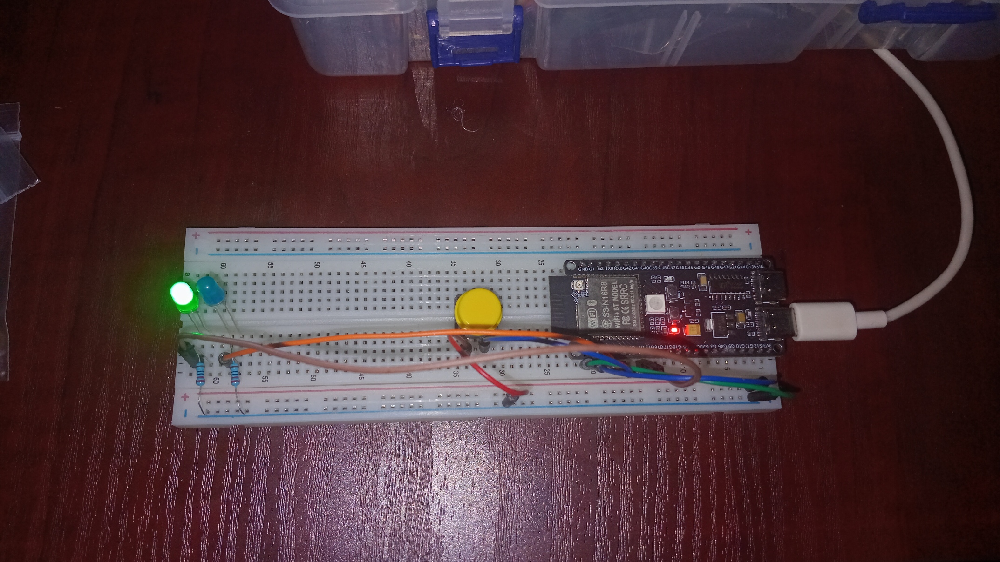
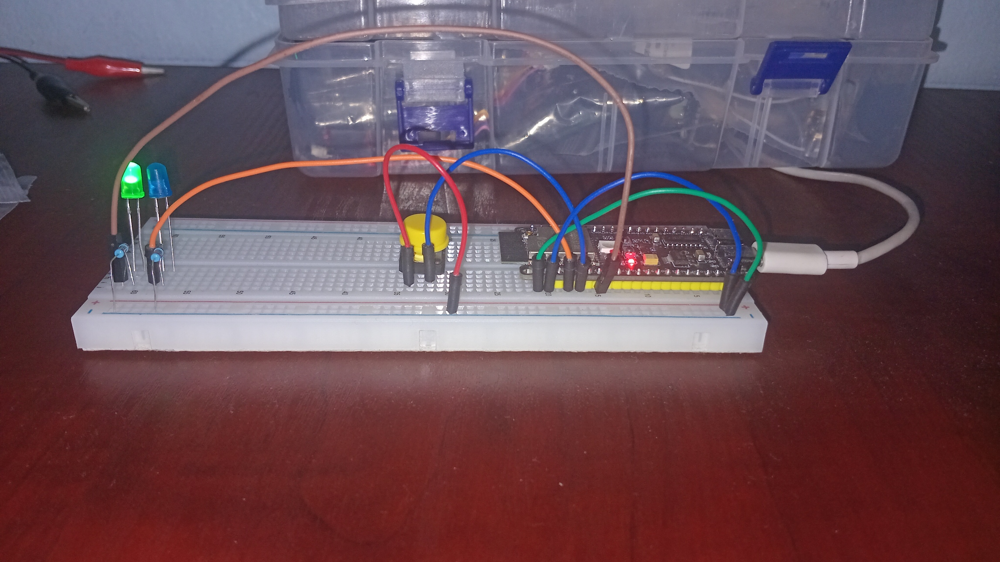

# ESP32-S3-Hardware-Interrupts

# ESP32-S3 Hardware Interrupts – LED Pattern Controller

## 1. Project Overview

This project demonstrates hardware interrupt handling using an ESP32-S3 N16R8 development board.

A push button connected to GPIO 5 triggers an external hardware interrupt when a falling edge is detected.

The interrupt switches the program between two LED blinking patterns:

- **Mode 0:** Red LED blinks at 1000 ms intervals.
- **Mode 1:** Blue LED blinks at 2000 ms intervals.

The project explores how microcontrollers respond to external hardware events without relying exclusively on continuous polling.

The circuit was physically assembled, programmed and tested.

## 2. Hardware Components

| Component | Quantity |
|---|---:|
| ESP32-S3 N16R8 Development Board | 1 |
| Red LED | 1 |
| Blue LED | 1 |
| Push Button | 1 |
| Current-limiting resistors | 2 | 330 or 220 ohms
| Breadboard | 1 |
| Jumper wires | As required |

## 3. GPIO Pin Configuration

| Component | ESP32-S3 GPIO | Configuration |
|---|---|---|
| Red LED | GPIO 7 | OUTPUT |
| Blue LED | GPIO 4 | OUTPUT |
| Push Button | GPIO 5 | INPUT_PULLUP |

### Button Configuration

The push button uses the ESP32-S3's internal pull-up resistor.

- Button released: HIGH (3.3V).
- Button pressed: LOW (0V).

The interrupt is configured to trigger on the falling edge.

## 4. Operating Modes

### Mode 0 – Red LED

The red LED switches ON and OFF at 1000 ms intervals.

### Mode 1 – Blue LED

The blue LED switches ON and OFF at 2000 ms intervals.

Pressing the push button switches between the two operating modes.

## 5. Technical Concepts Explored

This project demonstrates the following embedded programming concepts:

| Concept | Description |
|---|---|
| Hardware Interrupts | Responding to external hardware events. |
| ISR | Interrupt Service Routine for handling interrupts. |
| `attachInterrupt()` | Registers an interrupt handler. |
| `digitalPinToInterrupt()` | Converts a GPIO pin into an interrupt identifier. |
| `FALLING` | Triggers an interrupt when the signal changes from HIGH to LOW. |
| `volatile` | Prevents the compiler from assuming asynchronously modified variables remain unchanged. |
| Button Debouncing | Prevents repeated triggers caused by mechanical button bouncing. |
| `millis()` | Measures elapsed time for debounce handling. |
| Boolean Flags | Communicates interrupt events to the main program loop. |
| Conditional Statements | Controls the LED patterns according to the active mode. |

## 6. Interrupt Handling

The interrupt is registered using:

```cpp
attachInterrupt(
  digitalPinToInterrupt(btnPin),
  interruptHandler,
  FALLING
);
```

The interrupt handler updates the operating mode and sets a flag.

Serial communication is handled inside `loop()` rather than directly inside the interrupt service routine.

This keeps the interrupt handler relatively short.

## 7. Button Debouncing

Mechanical push buttons can produce multiple electrical transitions when pressed.

A 500 ms debounce interval is implemented using `millis()` to prevent unwanted repeated mode changes.

## 8. Arduino Uno R3 Compatibility

An alternative Arduino Uno R3 implementation is included as commented-out code in the source file.

The Uno R3 implementation uses:

- Digital Pin 2 for the interrupt button.
- Digital Pin 3 for the red LED.
- Digital Pin 4 for the blue LED.

The ESP32-S3 implementation uses GPIO 5 for the interrupt button.

## 9. Project Images

Photographs of the physical circuit and working demonstration will be included below.

### Circuit Overview



### Working Demonstration



## 10. Learning Objectives

The primary objective of this project is to develop a practical understanding of interrupt-driven programming and hardware-software interaction.

This project forms part of my self-directed learning journey in:

- Embedded Systems Development
- Microcontroller Programming
- Electronics
- Robotics
- Firmware Development
- Internet of Things (IoT)

## 11. Author

**GitHub:** T5H3P4N9

This project was independently developed as part of my practical preparation for more advanced embedded systems and robotics engineering.

---

*Learn by building. Understand by experimenting. Improve by developing.*